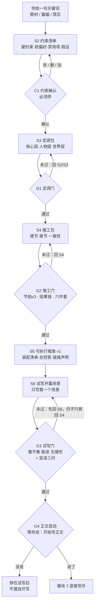
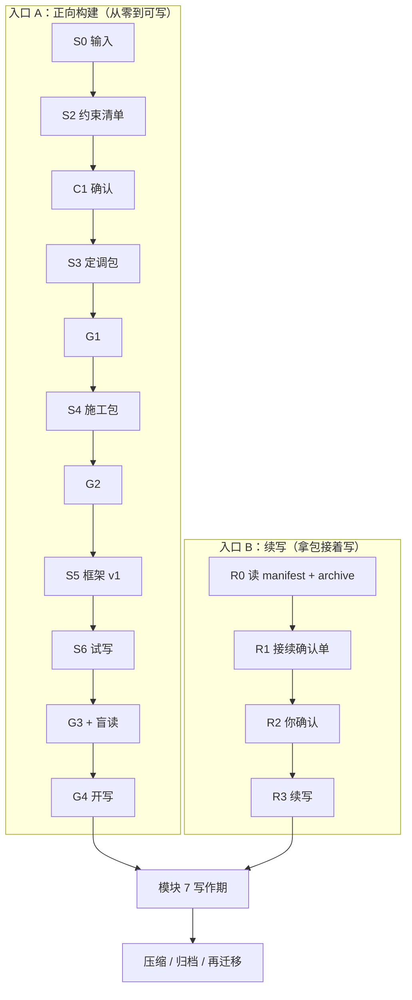
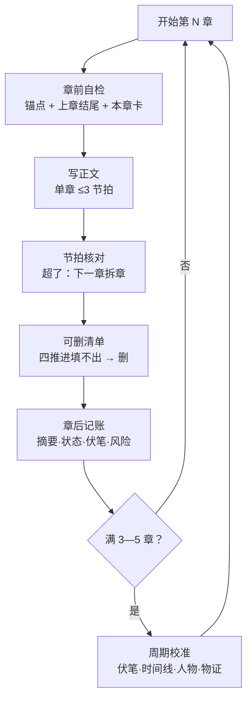
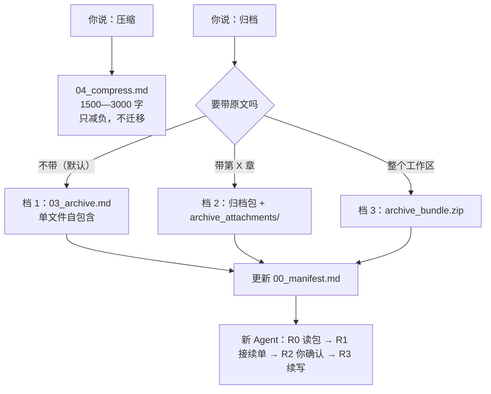

# novelist-skill


[](https://skills.sh/janekinsley/novelist-skill)

> **v0.2.0** ｜ 纯 Markdown ｜ MIT ｜ 优先面向有工作区的 Agent
>
> 把“写小说”拆成一条可确认、可验收、可迁移的流水线：
> **关键词 → 约束 → 定调（明确故事·人物·世界）→ 施工（明确情节·章节·一致性）→ 试写 → 正文**
>
> 每一步只产出一件东西、只过一道关；写作期再管住上文与一致性。
>
> 仓库：<https://github.com/JaneKinsley/novelist-skill>　｜　目录页：<https://skills.sh/janekinsley/novelist-skill>

---

## 30 秒上手

```text
① npx skills add JaneKinsley/novelist-skill   →  ② 说一句关键词  →  ③ 跟着门禁说“确认”
```

| 步 | 你要做的事 | 大约耗时 |
|---|---|---|
| ① 安装 | 跑一行 `npx skills add JaneKinsley/novelist-skill`，按提示选 agent | 1 分钟 |
| ② 开口 | 一句题材 + 篇幅 + 禁忌，例如“近未来记忆租赁，冷峻短句，不要穿越，中篇” | 10 秒 |
| ③ 过门 | Agent 每出一版产物就停下等你；你说“确认 / 改 X / 回退”，它才继续 | 每关 1—3 轮 |

第一次跑到正文，大约 5—8 轮对话。之后每写一章，只读三个文件、走一圈：自检 → 写 → 核对 → 删改 → 记账。

> 以下流程图用 Mermaid 绘制。GitHub、Typora、Obsidian、VS Code（装 Mermaid 插件）可直接渲染；不支持的阅读器会显示为代码块，顺着箭头读即可。

---

## 1. 这是不是你要的东西

| 你的处境 | 结论 |
|---|---|
| 只有几个关键词，想长出一本结构完整、能一章章写下去的书 | ✅ 正是为此设计 |
| 已有想法，想要能验收的大纲，而不是一堆灵感 | ✅ 用 |
| 写到一半，人物/时间线/伏笔开始打结 | ✅ 用（模块 7） |
| 想换台电脑、换个 Agent 接着写 | ✅ 用（归档 + 接续单） |
| 已经有完整书稿，只想润色句子 | ❌ 不适用 |
| 要求逐字模仿某位在世作家的文风 | ❌ 明确拒绝 |
| 想要“保证好看” | ❌ 见下一节，它保证的不是这个 |

---

## 2. 它保证什么、不保证什么

**这一节比后面所有表格都重要。**（规范 1.7）

| 能保证（可检查） | 不能保证（靠人与模型） |
|---|---|
| 结构有效：节点齐全、章末有变化、节拍不超编 | 语言辨识度：这句话只能由这个人说出来 |
| 情节有内在必然性：因果链不断 | 情感真实：读者会不会被触动 |
| 人物有一致性：动机表、知识边界、行为底线 | 人物可信：读者会不会“不同意却相信” |
| 信息出场顺序正确：该知道时才让他知道 | 主题深度：不喊口号、呈现复杂性 |
| 细节能承重、伏笔能回收、数字能对上 | 原创眼光与多义重读 |

**三条使用纪律**

1. 任何门禁通过，只代表“这一层的形式要求满足”，不代表作品成立。
2. 自检报告不会出现“可交稿”“已达到标准”，只写“通过 / 未过 + 未过项”。
3. 真人读者的意见，优先于 skill 的任何自检结论。

---

## 3. 安装

**最快一行**——自动识别你机器上的 agent 并装好：

```bash
npx skills add JaneKinsley/novelist-skill
```

会列出仓库里的 skill，让你选 agent（Claude Code / Codex / Cursor / Copilot / Windsurf 等 79 种）和范围（项目级 / 全局）。加 `-g` 装到全局，加 `-a claude-code -y` 免交互。

| 方式 | 适合 | 做法 |
|---|---|---|
| **skills CLI**（推荐） | 大多数 agent | `npx skills add JaneKinsley/novelist-skill` |
| **Claude Code 插件** | 只用 Claude Code | `/plugin marketplace add JaneKinsley/novelist-skill`，再 `/plugin install novelist-skill@novelist-skill`（两步都要） |
| **手动复制** | 想自己控制位置 | `git clone` 后把 `skills/novelist-skill/` 拷进 skills 目录 |
| **下载 ZIP** | 不装 git | 仓库页 **Code → Download ZIP**，解压后取 `skills/novelist-skill/` |
| **粘贴模式** | 无文件系统、网页版 | 把 `SKILL.md` 模块 8.2 的系统提示词贴进 system prompt |

手动复制的完整命令：

```bash
git clone --depth 1 https://github.com/JaneKinsley/novelist-skill.git /tmp/ns
mkdir -p ~/.claude/skills
cp -R /tmp/ns/skills/novelist-skill ~/.claude/skills/
```

手动复制时的常见 skills 目录：

```text
用户级（整机可用）   ~/.claude/skills/   ~/.codex/skills/   ~/.agents/skills/
项目级（只此项目）   <项目>/.claude/skills/   <项目>/.agents/skills/
Windows             %USERPROFILE%\.claude\skills\novelist-skill\SKILL.md
```

**两条硬要求**：目录名必须等于 frontmatter 的 `name`（即 `novelist-skill`）；`SKILL.md` 首行必须是 `---`。

> 只有 `SKILL.md` 是必需的，`templates/` 只是省手抄的预填骨架——附录 B 已内联全部模板。

---

## 4. 建工作区

工作区模板在仓库的 `skills/novelist-skill/templates/`；装好之后，它就在 skill 目录里的 `templates/`。

```bash
# 在克隆下来的仓库里：
cp -R skills/novelist-skill/templates/. ../my-novel/

# 或者已经装进 skills 目录：
cp -R ~/.claude/skills/novelist-skill/templates/. ../my-novel/
```

或者直接说：“按 1.6 的目录结构在 `my-novel/` 建工作区”。

三个文件建完就要填：`00_manifest.md`（项目索引）、`01_anchor.md`（常驻锚点）、`02_state.md`（状态账本）。其余按需生成。

---

## 5. 第一次跑：完整流程图



**每一步只产出一件东西**——图看流程，表看产出：

| 阶段 | 产出 | 这一步「明确」什么 | 停在哪 |
|---|---|---|---|
| 关键词 | —（一段输入） | 起点：题材、篇幅、禁忌 | — |
| 约束 | 约束清单 | **能写什么、不能写什么**：硬约束 / 禁用项 / 假设 | C1 你确认 |
| 定调 | 定调包 | **故事·人物·世界**：故事成不成立、人物撑不撑得起、世界有没有压力 | G1 |
| 施工 | 施工包 | **情节·章节·一致性**：怎么升级、每章写什么、前后哪里会打架 | G2 |
| 试写 | 开篇一个场景 | 笔调像不像、读者能不能读下去 | G3（含盲读） |
| 正文 | 逐章正文 | 你点了头没有 | G4 |

**你的第一条消息**（可直接复制）：

```text
用 novelist-skill 开一本新书。
关键词：近未来，记忆可以租赁，主角是租赁公司的调查员；
冷峻短句，不要穿越；中篇，约 4 万字。
先出约束清单，等我确认。
```

**预期回应**：一张五列约束清单（类型 / 内容 / 来源 / 影响层级 / 处理），然后停下问你“确认还是修改”。

---

## 6. 两道入口与六个确认点



**入口怎么选**：只给关键词 → 入口 A；明确说“续写 / 接着写 / 从归档继续” → 入口 B。

| 关卡 | 检查什么 | 你要做的 | 不过会怎样 |
|---|---|---|---|
| **C1** 约束确认 | 约束是否可检查、冲突是否标注、假设是否显性 | 增删改，然后说“确认” | 不生成定调包（停在此） |
| **G1** 定调门 | 故事成立、人物撑得起、世界有压力 | 说“通过”，或指出要改的字段 | 回 S2（改约束）或 S3（改定调） |
| **G2** 施工门 | 节拍 ≤3、因果链不断、六件套齐全、行为动机表齐全 | 同上 | 回 S4，严重时回 G1 |
| **G3** 试写门 | 像不像 / 能不能继续读 / 有无硬伤 **+ 盲读三问** | 找个没看过大纲的人读；无人可读就自问三问并注明 | 回 S6（换写法）或 S4 |
| **G4** 正文启动 | 你是否明确要开写 | 说“开始写正文” | 停在试写后，不擅自写 |
| **R1** 接续确认 | 归档包与状态是否对得上 | 看接续确认单，说“对，继续” | 先补包，不得硬写 |

**盲读三问**（G3）：他是谁？他为什么这么做？想不想读下一章？——答不出，说明形式过了、经验层没过。

---

## 7. 写作期：一章的循环



**每轮只读三个文件**：`00_manifest.md` + `01_anchor.md` + `02_state.md`。其余按任务追加——不默认读全章节，也不默认读历史版本。

| 环节 | 一句话标准 |
|---|---|
| 章前自检 | 锚点、上章结尾、本章卡三者不打架 |
| 节拍核对 | 把本章写成一句话，若要“然后又……然后又……”就是超了 |
| 可删清单 | “事件 / 关系 / 信息 / 人物”四推进一栏填不出，默认删 |
| 章后记账 | 不记账 = 本章未完成（含节拍核对与可删清单两项） |
| 周期校准 | 每 3—5 章一次，长篇每卷末强制 |

---

## 8. 压缩、归档、续写



| 你的说法 | 产出 | 拿什么走 |
|---|---|---|
| “压缩” | `04_compress.md` | 不用带走，本会话减负用 |
| “归档” | `03_archive.md` | 一个文件即可换 Agent 续写 |
| “归档，带第 3 章” | 归档包 + 附件目录 | 包 + `archive_attachments/` |
| “打包工作区” | `archive_bundle.zip` | 整个 zip |

归档包是自包含的：新 Agent 不读旧对话也能回答“什么故事、写到哪、人物什么样、哪些伏笔没回收、下一章写什么”。

---

## 9. v0.2 新增：13 条防翻车规则

v0.2 的修订都指向同一件事——**把“感觉”变成“可检查”**。

| 管什么 | 规则 | 怎么用 | 违反了 |
|---|---|---|---|
| 结构 | **节拍配额**：单章 ≤3 个节拍，每节拍 700—1,100 字 | 超了就**拆章**，不许压字数 | G2 不过 |
| 结构 | **因果链三段**：因为 A → 所以 B → 因此 C | 一条设定最多跨两步；缺一段即断链 | 断链回 S4 |
| 结构 | **六件套**：自检表→可写性四问→**行为动机表**→修正建议→待确认→交接单 | 少一件不过门 | G2 不过 |
| 信息 | **出场顺序表**：首次出场只用最基础用法 | 专业用法等动机建立之后 | G2 不过 |
| 信息 | **命名纪律**：见名知意、一名字一功能、首次句内自解释 | 说不清就换词，不要解释 | 重命名 |
| 信息 | **称谓与层级**：机构 / 门店 / 行话 / 商品各一套叫法 | 正文里每个名字都要能在表里找到唯一对应 | 回 S4 |
| 人物 | **人物档案**：每人一张，目的四层缺一不可 | 写任何有人物出场的场景前先读 | G1 不过 |
| 人物 | **行为双栏**：读者可以不同意，但必须理解 | “不理解”＝缺铺垫，回 S4 | G2 不过 |
| 人物 | **反派不洗白**（可选条款，用户要求时启用） | 不给悲情前史、不给同情出口 | 按约定 |
| 一致性 | **第五表：物证与数字** | 编号、年龄、日期、金额全篇对齐 | 一致性检查 |
| 验收 | **盲读三问** | 找没看大纲的人读 | G3 不过或注明缺席 |
| 验收 | **可删清单** | 每章至少执行一次 | 本章未完成 |
| 输入 | **来源隔离**：`用户明示` 只能来自当前对话里说过的话 | 工作区旧文件默认不算输入，先问一句 | 出变更表降级 |

另外两条边界：**篇幅—章数—节拍换算表**（先定总字数，章数自然出来，不要先定章数）；**能力边界声明**（见本文第 2 节）。

---

## 10. 用户指令速查

| 你说 | 它做什么 |
|---|---|
| “确认 / 通过 / 可以” | 当前门禁记为通过，进下一状态 |
| “改 X / 把 X 换成 Y” | 只改指定项，出变更表，不重贴全量 |
| “回退 / 退回上一步” | 退到指定层，标回退点 |
| “查看全量 / 完整给我” | 输出当前产物全量版 |
| “连续输出 / 一口气出完” | 连续生成，但**不跳自检**，门禁仍停 |
| “试写 / 先写一段看看” | 只写开篇第一个场景，不计入正式字数 |
| “开始写正文” | G3 通过后进入逐章写作 |
| “压缩 / 归档 / 打包工作区” | 见第 8 节 |
| “总结 / 现在到哪了” | 汇报进度、版本、未决项 |
| “重试 / 换个写法” | 重写试写片段，标版本 B/C |

规则：一词多义先确认；词典没覆盖的不会硬猜。

---

## 11. 目录与文件

**仓库结构**（安装时只取 `skills/novelist-skill/`）：

```text
novelist-skill/
├── .claude-plugin/
│   ├── plugin.json         插件元信息
│   └── marketplace.json    市场目录
├── skills/novelist-skill/  ← 真正的 skill
│   ├── SKILL.md            规范全文：模块 0—11 + 附录 A/B
│   ├── README.md           skill 内导读（与本文件同源）
│   └── templates/          工作区骨架
├── README.md               本文件（仓库首页）
├── CHANGELOG.md
└── LICENSE
```

**工作区结构**（`templates/` 展开后，复制到小说项目里填写）：

```text
my-novel/
├── 00_manifest.md           项目索引：唯一入口，每轮必读
├── 01_anchor.md             L0 锚点：梗概 / 主角四件套 / 当前章目标
├── 02_state.md              状态账本 + 三表：人物 / 时间线 / 伏笔 / 风险
├── 03_archive.md            归档包（迁移用）
├── 04_compress.md           压缩包（减负用）
├── framework/
│   ├── characters.md        人物档案：每人一张，目的四层
│   ├── constraint.md        约束清单（S2）
│   ├── tone.md              定调包（S3）
│   ├── construction.md      施工包（S4）
│   └── index.md             可执行框架 v1 总控台（S5）
├── style/sample.md          风格样例 200—300 字
├── changelog/changes.md     变更表
├── chapters/vol01/          章节原文
├── versions/                历史版本
└── archive_attachments/     归档原文附件（档 2 才有）
```

| 文件 | 什么时候读 | 默认载入 |
|---|---|---|
| `00_manifest.md` | 每轮 | ✅ |
| `01_anchor.md` | 每轮 | ✅ |
| `02_state.md` | 每轮 | ✅ |
| `framework/characters.md` | 写任何有人物出场的场景前 | ❌ |
| `chapters/` | 写下一章读最近 1 章；查一致性读指定章 | ❌ |
| `style/sample.md` | 需要语感时 | ❌ |
| `03_archive.md` / `04_compress.md` | 迁移 / 上下文重置时 | ❌ |

**总则**：文件存在 ≠ 已载入。不默认读全章节、不默认读历史版本。

---

## 12. 常见问题

**没有工作区能用吗？**
能，退化为粘贴模式：你把产物贴回来，它继续。但没有记账、压缩、归档，长文一致性会打折。

**能跳过试写直接写正文吗？**
不能。G3、G4 是硬关卡——这是 v0.1 起就定下的，v0.2 只是在 G3 上加了盲读。

**写出来还是不好看怎么办？**
这个 skill 管“不犯低级错误”，不管“好看”。让真人盲读，把意见带回来，比让它再自检十遍有用。

**写到一半想改前面的设定？**
走变更表。A 级（主角欲望 / 核心冲突性质 / 世界核心规则 / 结局方向）硬停、回对应门禁；B/C 级标假设、包末清算。写作期回改上游目前只有这条路径。

**换电脑 / 换 Agent 怎么接？**
说“归档”，拿走 `03_archive.md`；新环境里说“续写”，它会先出接续确认单，你确认后才动笔。

**多少字算中篇？**
按 5.8：短篇 ≤1.5 万、中篇 1.5—8 万、长篇 >8 万；章数由“总字数 ÷ 每章 2—3 节拍”倒算，不要先定章数。

---

## 13. 文档地图

| 你想知道 | 去哪看 |
|---|---|
| 流程与门禁 | 模块 3、6 |
| 五类产物的字段 | 模块 4 |
| 每一层怎么写才合格 | 模块 5（含命名纪律、称谓表、篇幅换算） |
| v0.2 的因果链 / 出场顺序 / 删改标准 | 4.7 / 4.8 / 4.10 |
| 写作期读取、记忆、压缩、归档、续写 | 模块 7 |
| 可直接粘的系统提示词 | 模块 8.2 |
| 全流程示例（记忆租赁悬疑） | 模块 9 |
| 异常与边界 | 模块 10 |
| 待办与已知限制 | 模块 11 |
| 字段速查 | 附录 A |
| 可复制模板 | 附录 B |

---

## 14. 版本与许可

- **版本**：`0.2.0`（2026-11-03）｜与 `SKILL.md` frontmatter 一致
- **v0.2 修订**：15 项，集中在结构、信息、人物、一致性、验收、输入、边界七处，逐条见 `SKILL.md` 11.2
- **仓库**：<https://github.com/JaneKinsley/novelist-skill>
- **目录页**：<https://skills.sh/janekinsley/novelist-skill>
- **许可**：MIT
- **维护**：HJB

`SKILL.md` 是唯一规范源；本 README 只做导读，两者冲突时以 `SKILL.md` 为准。
